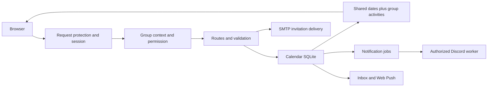

# Developer handbook: Tutel Calendar

> Deployment update, 13 October 2026: live Calendar and `/admin` Panel now run on ora. Music primary is homeserver, standby is ora; oracle applications are retired. [Current deployment and recovery](ORA-DEPLOYMENT.md). Earlier dated deployment descriptions below are historical.

[Current feature guide / คู่มือคุณสมบัติปัจจุบัน](CURRENT-FEATURES.md)

## Invitation/account update — 10 October 2026

Email/link invitations now accept any signed-in Google/Discord account, require explicit acceptance and allow one successful use. Automatic email-matched joining has been removed. Users can set a persistent display name; managers additionally see the original provider name and verified email. See [current behavior and API](INVITATIONS-AND-PROFILE.md). This replaces older descriptions of preassignment and email-matching below.

[ภาษาไทย](DEVELOPMENT.th.md) · [Contribution workflow](../CONTRIBUTING.md) · [Current deployment](CURRENT-STATUS.md)

Updated 10 October 2026. For runtime status, CURRENT-STATUS.md is authoritative. This guide explains how to develop and hand over the source; it does not claim that pending bot cutover or delivery tests have been completed.

## Contents

1. Boundaries and reading order
2. Local setup and fixtures
3. Configuration and libraries
4. Request, identity and event flows
5. Feature modification map
6. Database migrations and shared dates
7. Frontend, mobile and accessibility
8. Service contracts and reminders
9. Verification and debugging
10. Release, rollback and handover

## 1. Boundaries and reading order

Calendar owns users/identities, sessions, groups, invitations, approval, preferences, SQLite, inbox/Push/email and delivery jobs. The separate music repository owns the Discord connection, audio, cluster election and private server control panel. Calendar management roles do not grant server-control access.

Read in this order: package.json/.env.example → src/server.js → database/connection.js, migrations.js and groups/schema.js → auth/oauth.js and groups/access.js → events/routes.js and published.js → public/app.js/groups.js/settings.js → integrations/discord/ and control/.



server.js composes middleware/routes, starts reminder/import timers, serves static assets and handles shutdown. Database initialization is synchronous and runs on module import. Do not import the real server/connection as a harmless helper in an isolated test.

## 2. Local setup

Use Node.js 24+ (including node:sqlite), npm and Git. No separate SQL server is needed.

```powershell
git clone https://github.com/DoubleP987/tutel-calendar.git
cd tutel-calendar
npm ci
Copy-Item .env.example .env
npm start
```

Open http://127.0.0.1:3100. The example binds loopback and enables demo mode. The UI can preview member/manager roles. SQLite/fixtures are created in the configured data directory. Keep the demo database separate from production. Demo fixtures are teaching records, not a complete holiday feed.

For an isolated development copy, set DATABASE_PATH=./data/dev-calendar.sqlite, clear CALENDAR_SOURCE_URL and SMTP_* credentials, and leave service secrets blank. Do not copy production SQLite: it contains users, sessions, invitations and Push subscriptions. Do not expose demo mode through a tunnel or LAN bind.

Production-like local OAuth requires a trusted HTTPS URL, ENABLE_DEMO=0, matching BASE_URL/callbacks and a provider client configured for that environment. HTTP real OAuth is rejected by server.js. OAuth setup is not equivalent to enabling Google Calendar API; this application only needs basic identity scopes.

## 3. Environment and dependencies

| Variable                                                      | Purpose / constraint                                              |
| ------------------------------------------------------------- | ----------------------------------------------------------------- |
| HOST / PORT / BASE_URL                                        | Listener and trusted origin; example loopback:3100                |
| ENABLE_DEMO                                                   | Local role preview only; public production must be 0              |
| DATABASE_PATH                                                 | Calendar's own SQLite file, relative to process working directory |
| GOOGLE_CLIENT_ID / GOOGLE_CLIENT_SECRET                       | Google web OAuth client; exact callback URI                       |
| DISCORD_CLIENT_ID / DISCORD_CLIENT_SECRET                     | Discord web OAuth client; not a bot token                         |
| GOOGLE_ADMIN_IDS / DISCORD_ADMIN_IDS                          | Bootstrap privileged provider subjects; review before onboarding  |
| VAPID_PUBLIC_KEY / VAPID_PRIVATE_KEY / VAPID_SUBJECT          | Device Web Push keys; private key stays server-only               |
| CALENDAR_SOURCE_URL                                           | Optional HTTPS one-way legacy snapshot feed                       |
| CLOUDFLARE_TUNNEL                                             | Deployment security configuration; inspect http/security.js       |
| SMTP_HOST / SMTP_PORT / SMTP_FROM / SMTP_USER / SMTP_PASSWORD | Optional invitation mail provider                                 |
| CALENDAR_BOT_SECRET                                           | Restricted delivery API, at least 32 characters                   |
| CALENDAR_CONTROL_SECRET                                       | Separate platform-management API key, at least 32 characters      |

`npm start` starts services. `npm run format` writes formatting; `npm run format:check` checks it. `node scripts/generate-vapid.js` generates and appends Push keys privately to .env without printing the secrets. Keep that file outside Git. Do not rotate existing VAPID keys casually; existing subscriptions can depend on them.

Express supplies routing/middleware; Helmet adds response security headers/CSP. dotenv loads environment. Node's DatabaseSync supplies SQLite. nodemailer sends SMTP; web-push sends encrypted browser Push messages. Multer parses bounded multipart uploads; Sharp validates, resizes and re-encodes Feedback images. Browser UI uses native modules/DOM/CSS; there is no React build or bundler requirement. Prettier changes formatting, not application behavior. Installed versions belong in the dependency lockfile.

## 4. Trace a request and event

### Authentication

Browser begins /auth/google or /auth/discord → provider consent → matching callback → server validates browser-bound single-use state (Google uses PKCE) → resolves provider identity → creates a session. Session tokens are random; the database stores hashes. Cookies are HttpOnly, SameSite=Lax and Secure over HTTPS. Session expiry is fixed, not indefinitely refreshed by activity.

Google scopes are openid/email/profile; Discord identify/email supports verified-address invitations. Matching names/emails never automatically merge accounts. Explicit linking must prove both identities and handle already-linked conflicts. See auth/link-accounts.js before changing identity ownership.

### Group request

The frontend api() helper attaches x-calendar-group and CSRF for mutations. groupContext resolves the header, query or saved last group, validates membership/suspension and assigns request context. readGroup, requireGroupMember, manageGroup and ownerGroup enforce the needed permission. Knowing a slug or editing a header does not grant membership. Platform administrator access is a distinct audited privilege.

### Event proposal

POST /api/events → member + CSRF + group guard → validate title/date/time/color/category → apply group's manual/trusted/all policy → insert native group event → audit → notify according to preferences. Pending proposals stay out of published reads. Review updates only pending records; duplicates receive conflict. Editing native data and editing imported data have different policies.

### Public event display

GET /api/events → group read authorization → publishedEvents(groupId) combines shared dates and authorized selected-group activities → strips account/review metadata → browser category/search/date rendering. Non-member public-group reads include general dates only. Private groups reject non-members. Simultaneous multi-group aggregation and explicit Discord-link viewing remain pending.

## 5. Where to change a feature

| Feature                 | Modules                                                | Required considerations                                         |
| ----------------------- | ------------------------------------------------------ | --------------------------------------------------------------- |
| Proposal field          | events/routes.js, database migrations, public forms    | Validation, old rows, private/public serialization              |
| Group role/invitation   | groups/access.js, invitations.js, routes.js            | Ownership, expiry, suspension, atomic acceptance                |
| Login/account linking   | auth/oauth.js, link-accounts.js                        | State/PKCE, verified identity, provider conflicts               |
| Category                | events/categories.js                                   | Stable ID, default filters, notification choices, imported tags |
| Shared dates            | events/published.js, legacy importer, groups/schema.js | No copies, no private activities promoted to shared             |
| User settings           | members/preferences.js, public/settings.js             | Validation, per-membership persistence, stale async writes      |
| Display/sidebar         | public/app.js, index.html, styles.css                  | All views, mobile focus, filters, theme and cache version       |
| Email                   | notifications/email.js, groups/routes.js               | Configured SMTP, recipient binding, failure/link fallback       |
| Web reminders/Push      | notifications/scheduler.js, service.js, public/sw.js   | Per-group preferences, dedupe, device consent                   |
| Discord jobs            | integrations/discord/jobs.js, bindings.js              | Group/channel scope, atomic claims, uncertain sends             |
| Private platform bridge | integrations/control/routes.js                         | Service key, actor/audit, browser secrecy                       |

Example additive browser route structure (illustrative; add real validation and logic):

```js
app.post('/api/example', member, csrf, groupContext, requireGroupMember, (req, res) => {
  // Validate req.body; use req.group.id and req.session.id, never client-supplied ownership.
  res.json({ ok: true });
});
```

Guard order matters. A manager route also needs manageGroup; an owner action needs ownerGroup. Read all mutations for the same resource to avoid protecting only the visible UI button.

## 6. Schema, transactions and shared dates

connection.js initializes migrations.js then groups/schema.js, followed by gated demo fixtures. Tables include users/identities/sessions, groups/memberships, events, invitations, notifications/subscriptions, bindings/jobs and audit. A membership, not the global user name, owns the per-group role/preferences.

Schema changes should be additive and idempotent. Check table_info before adding columns, provide defaults for existing rows, backfill precisely, and record a migration marker when needed. Use a transaction for multi-step invariants such as group+owner creation or consuming an invitation. Parameterize values; never concatenate user input into SQL identifiers or expressions.

`data_scope=shared` stores imported general dates once. `data_scope=group` stores native/imported group activities. General rows retain a legacy storage group_id but are read independently of that group's access. User-created holiday-category records must remain group-scoped. UNION ALL is safe because scopes are disjoint; its prepared queries and partial indexes avoid duplicate copies and repeated preparation. See SHARED-CALENDAR.md.

When adding a field: migration/default → input validation → write/query/serialization → frontend form/view → reminder/export contract if relevant → docs. Existing imported IDs and event deep links must remain stable. Missing upstream records are currently retained; do not add deletion behavior without a reconciliation/rollback plan.

Use SQLite backup or a consistent stopped/WAL-aware snapshot. Copying the live .sqlite file alone can omit WAL changes. A shared network SQLite file is not a multi-host database strategy. Before restoring, stop all writers and preserve the current database separately.

## 7. Frontend and accessibility

app.js owns view state, calendar rendering and the browser API helper. groups.js owns the group/invitation dialogs; settings.js handles extended settings. Keep these boundaries; extract a focused module when a feature grows instead of making server logic dependent on browser state.

Use textContent/DOM nodes for user text. A hidden control does not enforce authorization. Browser values must be validated again on the server. Keep categories and notification settings distinct. Signed-in preferences persist per membership; guest storage is group-keyed. Theme is browser-local.

Mobile drawer behavior includes expanded-state labeling, focus management/trapping, inert main content, outside-tap/Escape close, restored desktop controls and reduced-motion CSS. Preserve these when editing. Check narrow phones, portrait/landscape tablets and desktop; avoid adding extra header rows.

Static asset query versions in index.html and module imports must be bumped together when cached UI changes are deployed. Do not bypass service-worker/cache issues by clearing users' persisted data. Home Screen Push/badging requires browser/device support and consent; use a fallback inbox instead of assuming every device supports it.

## 8. Service contracts and reminder delivery

Browser sessions/CSRF are not service credentials. `/internal/v1/bot` uses the bot secret; `/internal/v1/control` uses a separate management secret. They are server-to-server only and require HTTPS except loopback development. Never use a PUBLIC_/VITE_/NEXT_PUBLIC_ environment variable for them.

Delivery job lifecycle: pending → claimed → sending → sent (or failed/uncertain/expired). Starting delivery and recording a Discord message are separate operations. A crash after send can leave uncertainty; retry only after reconciling the channel. Inspect jobs.js and the bot worker before changing state names or payloads. A broad API response must not leak user/review fields into Discord delivery embeds.

Binding configuration includes group/channel, categories, daily time, previous-day delivery and optional timed reminders. Web reminders have member-specific preferences and their own dedupe. The scheduler queries today/tomorrow rather than loading all historical events. Imported dates use Asia/Bangkok; source all-day ends are exclusive and converted to inclusive display dates.

SMTP failure must not destroy an invitation or pretend mail was sent. Email mode sends in one action; link/code modes do not also send mail. Confirmed CSV imports queue invitation emails per recipient. Existing active invitations can be resent with their original role; links are rotated only after confirmation. No invitation test email should be sent without authorization from the owner.

Current integration is still one-way legacy snapshot import. Native web activities do not reach the original Discord scheduler. Bot worker/panel activation needs coordinated migration, compatible bindings and disabling the old scheduler; do not create a two-way synchronization loop.

## 9. Verification and troubleshooting

The repository contains `tests/group-history.test.js`, an isolated Node test file, but has no npm test script. It is not a complete application test suite. Do not report format checking or service health as full behavior verification. The commands/checklist below are for a developer to run when verification is requested; they were not run just to write this guide.

```powershell
npm run format:check
node --check src/events/routes.js
node --check public/app.js
```

Manual checks on a separate local demo database:

- Guest public read; private read refusal; two groups with isolated events; membership suspension.
- Native proposal/manual review and auto-approval; stale review/edit conflict; ownership transfer protection.
- General dates shared once in a new group; no imported personal activity leak; category preferences persist.
- Invitation link/code, expiry/uses/revoke, CSV duplicate/invalid rows, exact verified-address claims.
- Account linking conflicts, logout/expiry, CSRF/origin rejection, request limits.
- Mobile drawer focus/close, month/week/list, multi-day display, light/dark theme, old cached assets.
- Reminder categories/time/dedupe; service-key isolation, lease expiry and uncertain-send recovery.

Future automated tests should use temporary databases and injected clock/network/mail/Push adapters. Current imports open the real configured DB and may start side effects; split composition from domain logic before importing them in a test. Tests must never contact production SMTP/OAuth/Discord accidentally.

| Symptom                     | Investigate                                                                   |
| --------------------------- | ----------------------------------------------------------------------------- |
| Startup rejects HTTP        | ENABLE_DEMO/BASE_URL; real OAuth requires HTTPS                               |
| Login callback fails        | Exact callback scheme/host/port/path, provider state and client configuration |
| Group appears empty         | Selected group, category filters, published status, shared import source      |
| 401 / 403                   | Session, group membership, blocked/suspended state, CSRF/origin               |
| Email invitation unsent     | SMTP configuration, provider response, invitation retained-link result        |
| Preferences not remembered  | Signed-in membership vs guest browser storage, group ID, save request         |
| Old mobile UI               | HTML/query-version/module cache and service worker                            |
| No native Discord reminders | Worker cutover pending, bindings and service keys; not a UI problem           |

Use `/api/health` for liveness only. Operational logs: `journalctl --user -u tutel-calendar.service -f`. Inspect sanitized operation errors; do not dump environment, bearer tokens, sessions or provider secrets.

## 10. Release, rollback and next maintainer

Use a branch, focused commits and the contribution checklist. Update API/schema docs and CURRENT-STATUS.md together. Add dependencies with npm install, commit both package files and install with npm ci. Prettier follows the repository config; avoid unrelated formatting churn.

Before deployment: record old revision/runtime unit, make a consistent backup, preserve .env and data/, check provider callbacks and tunnel origin. Upload source/public/docs and lockfiles as needed; install dependencies if changed; restart the existing user unit; inspect health/logs; perform acceptance checks only when authorized. API data changes do not require a Vercel redeploy. Do not expose SQLite or the private music panel through the Calendar hostname.

Rollback the application independently from the database. An additive schema should keep the previous release readable; otherwise restore from a known consistent backup with writers stopped. Keep the current database before replacement. Production app is `/home/doublep/tutel-calendar/app`, data is outside that directory; do not overwrite them with local demo files.

**Handover checklist:** repo/revision, Node version, service/tunnel ownership, secret access outside Git, OAuth callback/audience, bootstrap admin subjects, SQLite backup/restore plan, legacy importer source and deletion policy, SMTP sender/key lifetime, Push key lifecycle, group roles/bindings and pending worker activation. Keep a record of which behaviors were actually exercised.

**Known pending work:** grouped Discord worker cutover and channel migration; a separately running Calendar Discord client; multi-host web reminder coordination; comprehensive automated/browser/device tests; website failover and complete physical-device Push verification. Authorized multi-group display, bounded recurrence, group view links and the private-panel bridge are implemented. See CURRENT-STATUS.md.

## Mobile installation (10 October 2026)

`public/install.js` owns once-per-browser onboarding, iOS/iPad detection, standalone suppression and retained beforeinstallprompt handling. Native Android prompt runs only after a user click. `tutel-calendar-install-intro-v1` stores display acknowledgement, not account data. Sidebar entry reopens instructions. `public/install.html` and `install-guide.js` provide a bilingual themed guide. Do not imply iOS supports programmatic installation or that Android prompt availability is guaranteed. No new tracking or install API endpoint is used.

## Calendar trash (10 October 2026)

Owner-only deletion, exact-name confirmation and 30-day recovery are implemented. See [Group deletion](GROUP-DELETION.md) for authorization, APIs, cleanup, backups and legacy notification boundaries.

## Workflow update — 10 October 2026

See [Current workflow guide](WORKFLOWS.md) and [คู่มือภาษาไทย](WORKFLOWS.th.md). These replace earlier descriptions of immediate ordinary owner transfer, hard activity deletion and single-group-only display. Grouped Discord worker cutover remains pending; Source publication and runtime deployment are separate operations.

## Group history and directory (10 October 2026)

All authorized group members can read member names, group roles and join timestamps, and a paginated activity history with actor names, item titles and Bangkok timestamps. Management writes remain restricted. New audit snapshots preserve readable names after item deletion; old actions are not reconstructed. No invitation tokens or email addresses are exposed. See [Group history and directory](GROUP-HISTORY.md) for API changes, implementation and retention limitations. Server source changes require a restart as part of deployment.

## Source readability / รูปแบบโค้ดปัจจุบัน

See [the repository conventions](CODE-STYLE.md): explicit control-flow braces, one declaration per statement, paragraphs by responsibility, formatted embedded HTML and multiline SQL with bound parameters.
