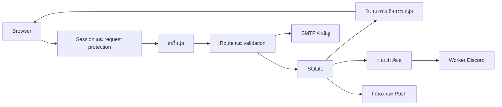

# คู่มือผู้พัฒนา Tutel Calendar

[English](DEVELOPMENT.md) · [ส่งงาน](../CONTRIBUTING.md) · [สถานะจริง](CURRENT-STATUS.md)

ปรับปรุง 10 ตุลาคม 2569 ใช้ CURRENT-STATUS.md อ้างอิงว่าอะไรขึ้นจริง คู่มือนี้ไม่ใช่หลักฐานว่า worker ใหม่หรือ delivery tests ทำเสร็จแล้ว

## สารบัญ

1. ขอบเขตและลำดับอ่านโค้ด
2. ตั้งเครื่องและข้อมูลตัวอย่าง
3. ค่า env และ library
4. เส้นทาง request/login/event
5. จุดแก้ฟีเจอร์
6. Schema migration และวันกลาง
7. UI มือถือและ accessibility
8. API ระหว่างบริการและแจ้งเตือน
9. ตรวจงานและ debug
10. Deploy ย้อนกลับและส่งต่อ

## 1. ขอบเขตและลำดับอ่านโค้ด

Calendar ดูแลบัญชี/identity/session กลุ่ม สมาชิก คำเชิญ อนุมัติ preferences SQLite inbox/Push/email และ jobs บอทเพลงอีก repo ดูแล Discord client เสียง cluster และ panel คุมเครื่อง Calendar manager ไม่มีสิทธิคุมเซิร์ฟเวอร์

เริ่ม package.json/.env.example → src/server.js → database/connection.js, migrations.js, groups/schema.js → auth/oauth.js, groups/access.js → events/routes.js, published.js → public/app.js, groups.js, settings.js → integrations/discord และ control



server.js ประกอบ middleware/routes เริ่ม timers/importer และ static server พร้อม shutdown DB initialization ทำตอน import module อย่า import server/connection จริงเป็น helper แล้วเข้าใจว่าจะไม่มี side effect

## 2. ตั้งเครื่องและข้อมูลตัวอย่าง

ใช้ Node.js 24+ ที่มี node:sqlite, npm และ Git ไม่ต้องติดตั้ง SQL server

```powershell
git clone https://github.com/DoubleP987/tutel-calendar.git
cd tutel-calendar
npm ci
Copy-Item .env.example .env
npm start
```

เปิด http://127.0.0.1:3100 ตัวอย่าง bind loopback และเปิด demo ให้ลอง member/manager ฐานและ fixtures สร้างใน data ที่กำหนด วันตัวอย่างไม่ใช่ข้อมูลวันหยุดครบจริง

ใช้ DATABASE_PATH=./data/dev-calendar.sqlite เว้น CALENDAR_SOURCE_URL, SMTP secrets และ service keys ว่างสำหรับ dev ที่ไม่ส่งออกจริง อย่าคัดลอกฐาน production เพราะมี users/session/invitations/Push ห้าม expose demo ผ่าน LAN หรือ tunnel

การลอง OAuth จริงต้อง trusted HTTPS, ENABLE_DEMO=0, BASE_URL/callback ตรง และ provider client ของ environment นั้น server.js ปฏิเสธ real OAuth ผ่าน HTTP ไม่ต้องใช้ Google Calendar API ระบบขอแค่ข้อมูลบัญชีพื้นฐาน

## 3. ค่า env และ library

| ค่า                                                           | ความหมาย                                                |
| ------------------------------------------------------------- | ------------------------------------------------------- |
| HOST / PORT / BASE_URL                                        | listener กับ origin ที่เชื่อถือ; demo loopback:3100     |
| ENABLE_DEMO                                                   | บทบาททดลองเฉพาะเครื่อง เว็บจริงต้อง 0                   |
| DATABASE_PATH                                                 | ไฟล์ SQLite คิด relative จาก working directory          |
| GOOGLE_CLIENT_ID / GOOGLE_CLIENT_SECRET                       | Web OAuth และ callback ตรง                              |
| DISCORD_CLIENT_ID / DISCORD_CLIENT_SECRET                     | Web OAuth ไม่ใช่ bot token                              |
| GOOGLE_ADMIN_IDS / DISCORD_ADMIN_IDS                          | provider subject สำหรับ bootstrap สิทธิ์ ต้องตรวจรายการ |
| VAPID_PUBLIC_KEY / VAPID_PRIVATE_KEY / VAPID_SUBJECT          | กุญแจ Web Push; private อยู่ server                     |
| CALENDAR_SOURCE_URL                                           | HTTPS snapshot import แบบทางเดียว                       |
| CLOUDFLARE_TUNNEL                                             | ค่า deployment security อ่าน http/security.js           |
| SMTP_HOST / SMTP_PORT / SMTP_FROM / SMTP_USER / SMTP_PASSWORD | ส่งเมลคำเชิญ                                            |
| CALENDAR_BOT_SECRET                                           | API delivery จำกัดสิทธิ์ อย่างน้อย 32 ตัว               |
| CALENDAR_CONTROL_SECRET                                       | API คุม platform คนละ key อย่างน้อย 32 ตัว              |

npm start เริ่มบริการ npm run format เขียนรูปแบบ npm run format:check ตรวจรูปแบบ node scripts/generate-vapid.js สร้างค่า Push สคริปต์บันทึกกุญแจลง .env โดยไม่พิมพ์ secret ห้ามนำไฟล์นี้ลง Git อย่าเปลี่ยน VAPID เดิมโดยไม่วางแผน subscription เก่า

Express ทำ route/middleware Helmet ตั้ง header/CSP dotenv โหลด env DatabaseSync ของ Node เป็น SQLite nodemailer ส่ง SMTP web-push ส่ง Push เข้าบราวเซอร์ UI ใช้ native JS modules/DOM/CSS ไม่มี React build หรือ bundler Prettier จัดโค้ด ไม่พิสูจน์พฤติกรรม ใช้ lockfile อ้างอิงเวอร์ชันจริง

## 4. เส้นทาง request/login/event

### Login

Browser เปิด /auth/google หรือ /auth/discord → provider → callback → ตรวจ state ที่ผูก browser ใช้ครั้งเดียว (Google มี PKCE) → หา identity → สร้าง session Token สุ่ม DB เก็บ hash Cookie เป็น HttpOnly, SameSite=Lax และ Secure เมื่อ HTTPS อายุ session เป็นเวลาคงที่ ไม่ต่อไม่สิ้นสุดเพราะขยับหน้า

Google ใช้ openid/email/profile Discord ใช้ identify/email สำหรับคำเชิญ verified address ไม่รวมบัญชีจากชื่อหรือเมลตรงกันเอง ต้องพิสูจน์สอง identity ผ่าน flow link และจัดการกรณี identity อยู่กับบัญชีอื่น อ่าน auth/link-accounts.js ก่อนแก้

### Request กลุ่ม

api() ฝั่งหน้าเว็บแนบ x-calendar-group และ CSRF เมื่อเปลี่ยนข้อมูล groupContext เลือกจาก header/query/last group แล้วตรวจสมาชิก ระงับ และ platform admin ต่อด้วย readGroup/requireGroupMember/manageGroup/ownerGroup ตามงาน รู้ slug หรือแก้ header ไม่ใช่สิทธิ์

### เสนอกิจกรรม

POST /api/events → member+CSRF+group guard → validate ชื่อ/วัน/เวลา/สี/หมวด → policy manual/trusted/all → insert native group event → audit/notify รายการ pending ไม่อยู่ใน published query การ review เปลี่ยนเฉพาะ pending คำสั่งซ้ำเจอ conflict กิจกรรมนำเข้าแก้ต่างจาก native

### แสดงผล

GET /api/events → ตรวจอ่านกลุ่ม → publishedEvents รวมวัน shared กับกิจกรรม selected group ที่มีสิทธิ์ → ตัด owner/review metadata → filter/search/date render ผู้ชมกลุ่ม public ได้แค่วันกลาง กลุ่ม private ต้องสมาชิก หลายกลุ่มพร้อมกันและ Discord-link viewing แบบใหม่ยังค้าง

## 5. จุดแก้ฟีเจอร์

| งาน             | ไฟล์หลัก                                        | ต้องคิดเพิ่ม                           |
| --------------- | ----------------------------------------------- | -------------------------------------- |
| field กิจกรรม   | events/routes.js, migration, form               | ข้อมูลเก่า validation serializer       |
| role/คำเชิญ     | groups/access.js, invitations.js, routes.js     | owner expiry blocked atomic accept     |
| login/link      | auth/oauth.js, link-accounts.js                 | state/PKCE verified conflicts          |
| หมวด            | events/categories.js                            | ID คงที่ default/notify/import tags    |
| วันกลาง         | events/published.js, importer, groups/schema.js | ไม่ clone/ไม่เปิดกิจกรรมส่วนตัว        |
| preferences     | members/preferences.js, public/settings.js      | validate ต่อ membership async write    |
| UI/sidebar      | public/app.js, index.html, styles.css           | ทุก view focus theme cache             |
| เมล             | notifications/email.js, groups/routes.js        | SMTP verified recipient fallback       |
| Push/reminders  | notifications/scheduler.js, service.js, sw.js   | กลุ่ม dedupe consent                   |
| Discord job     | integrations/discord/jobs.js, bindings.js       | claim lease uncertain/channel          |
| Platform bridge | integrations/control/routes.js                  | key actor audit ไม่ส่ง key ให้ browser |

ตัวอย่างโครง route (ต้องเพิ่ม validation/logic จริงเอง):

```js
app.post('/api/example', member, csrf, groupContext, requireGroupMember, (req, res) => {
  // ใช้ owner/group จาก request context ที่ตรวจแล้ว ไม่รับ ownership จาก client
  res.json({ ok: true });
});
```

ลำดับ guard สำคัญ manager action ต้อง manageGroup งาน owner ต้อง ownerGroup อย่าป้องกันเฉพาะปุ่ม UI หรือ route เดียวแล้วปล่อยอีก mutation เข้าถึงได้

## 6. Schema migration และวันกลาง

connection.js เรียก migrations.js → groups/schema.js → demo fixtures ที่เปิดเฉพาะ demo Tables มี users/identities/sessions groups/memberships events invitations notifications/subscriptions bindings/jobs/audit Role/preferences ของกลุ่มอยู่ membership ไม่ใช่ชื่อผู้ใช้ global

Migration ควร additive/idempotent ตรวจ table_info ก่อนเพิ่ม column กำหนด default ให้แถวเก่า backfill เฉพาะข้อมูลถูกชุด และ marker เมื่อจำเป็น ใช้ transaction สำหรับหลายขั้นที่ต้องสำเร็จร่วมกัน เช่นสร้างกลุ่ม+owner หรือรับคำเชิญ Parameterize ค่า ไม่ต่อ user input เป็น SQL

data_scope=shared เก็บวันทั่วไปที่นำเข้าครั้งเดียว data_scope=group เก็บ native/custom activity วันกลางมี storage group_id เดิมเพื่อ compatibility แต่สิทธิ์การอ่านไม่ผูกกลุ่มเก่า ห้ามทำ user event เป็น shared เพราะเลือกหมวด holiday UNION ALL ไม่ซ้ำเพราะ scopes แยกกัน ใช้ partial index และ prepared statements อ่าน SHARED-CALENDAR.md

เพิ่ม field: migration/default → validation → write/query/serializer → UI → reminder/export contract ถ้ากระทบ → docs รักษา source IDs/deep links ข้อมูลหายจาก feed ยังไม่ลบ ห้ามเปลี่ยนนโยบายโดยไม่มี reconciliation/rollback

สำรองด้วย SQLite backup หรือ snapshot ที่ consistent/WAL-aware คัดลอกไฟล์ .sqlite ตอนเขียนอย่างเดียวอาจไม่ครบ อย่าแชร์ SQLite live บน network ระหว่างเครื่อง Restore ต้องหยุด writers และเก็บฐานปัจจุบันก่อน

## 7. UI มือถือและ accessibility

app.js ดูแล state/render/api helper groups.js ดูแลกลุ่มและคำเชิญ settings.js ดูแลตั้งค่า แยก module เมื่อหน้าที่โต ไม่ให้ logic server ขึ้นกับ state browser

แสดง user text ด้วย DOM/textContent ซ่อนปุ่มไม่ใช่ authorization ตรวจค่า browser อีกทีที่ server หมวด display กับ notify คนละค่า Preferences สมาชิกแยกกลุ่ม ผู้ชม storage key แยกกลุ่ม Theme อยู่ browser

Drawer มี aria-expanded focus trap/restoration, main inert, แตะนอก/Escape ปิด, เปลี่ยน desktop คืน controls และ CSS reduced motion อย่าทำลายเมื่อตกแต่งใหม่ ลองมือถือแคบ iPad แนวตั้ง/นอน และ desktop ไม่เพิ่มแถบด้านบนกินพื้นที่

Static query version ใน index.html กับ module import ต้องเปลี่ยนสอดคล้องเมื่อ deploy UI ที่ cache อย่าแก้ cache โดยล้าง preferences ผู้ใช้ Home Screen Push/badge ต้อง consent และ device support ใช้ inbox fallback

## 8. API ระหว่างบริการและแจ้งเตือน

Browser ใช้ session/CSRF Service ใช้ secret คนละเรื่อง /internal/v1/bot เป็น key delivery /internal/v1/control เป็น key platform ใช้ HTTPS เว้น loopback ห้าม key ใน PUBLIC_/VITE_/NEXT_PUBLIC_ vars

Jobs มี pending → claimed → sending → sent หรือ failed/uncertain/expired การส่ง Discord กับบันทึก message ID เป็นสองขั้น Crash หลังส่งอาจ uncertain ต้องตรวจช่องก่อน retry อ่าน jobs.js และ worker อีก repo ก่อนเปลี่ยน payload/state ห้ามเอา owner/review fields ลง Discord

Binding มี group/channel/categories/daily time/previous-day/timed Web reminders ใช้ preferences ต่อ member และ dedupe ต่อกลุ่ม Query วันนี้/พรุ่งนี้ แทนทั้งหมด เวลา Asia/Bangkok All-day source end เป็น exclusive ต้องแปลง inclusive สำหรับ display

เมลล้มเหลวต้องเก็บคำเชิญและไม่รายงานว่าส่งแล้ว Email ส่งในขั้นเดียว Link/code ไม่ส่งเมล CSV ที่ยืนยันแล้วจะเข้าคิวส่งอีเมลทีละคน ดูสถานะและกดส่งซ้ำได้ในคำเชิญทั้งหมด อย่าส่งทดสอบให้คนอื่นโดยไม่มี authorization

ยังเป็น one-way import กิจกรรม native ยังไม่ถึง scheduler Discord เดิม ต้องย้าย bindings ปิด scheduler เก่าและเปิด worker พร้อมกันตามแผน อย่าทำ sync ย้อนกลับวนกัน

## 9. ตรวจงานและ debug

repo นี้ **ยังไม่มี automated test suite หรือ npm test script** ห้ามเรียก format check/health ว่าทดสอบระบบครบ คำสั่งต่อไปนี้ให้ dev ใช้เมื่อมีคำสั่งให้ตรวจ ไม่ได้รันแค่เพื่อเขียนคู่มือ:

```powershell
npm run format:check
node --check src/events/routes.js
node --check public/app.js
```

Manual checklist บน demo DB แยก:

- Guest public/private deny สองกลุ่มไม่ปน block membership
- เสนอ/review/manual-auto stale review/edit และป้องกัน owner
- กลุ่มใหม่เห็นวันกลางครั้งเดียว ไม่มี private leak จำ category
- คำเชิญ link/code expiry/uses/revoke CSV invalid/duplicate verified-email claim
- Link conflict logout/expiry CSRF/origin/request limits
- Drawer focus/close ทุก view multi-day theme/cache
- Reminder เวลา/dedupe/service key/lease/uncertain recovery

Test ในอนาคตใช้ temporary DB และ inject clock/network/mail/Push โค้ดปัจจุบัน import อาจเปิด DB จริง ต้องแยก composition ก่อน ห้าม test ติดต่อ production services โดยเผลอ

| อาการ                         | จุดตรวจ                                      |
| ----------------------------- | -------------------------------------------- |
| HTTP startup ไม่ได้           | real OAuth ต้อง HTTPS หรือใช้ demo loopback  |
| Callback fail                 | scheme/host/port/path/state/client           |
| กลุ่มว่าง                     | group/filter/status/import/shared reader     |
| 401/403                       | session/member/blocked/suspended/CSRF/origin |
| เมลไม่ส่ง                     | SMTP/provider result/link fallback           |
| Preferences หาย               | membership vs guest storage/group/save       |
| UI เก่า                       | asset query/cache/service worker             |
| Native event ไม่เตือน Discord | cutover ยังไม่เปิด ไม่ใช่ bug UI อย่างเดียว  |

/api/health บอก liveness ไม่ใช่ทุกฟีเจอร์ Log: journalctl --user -u tutel-calendar.service -f ใช้ error ล้างข้อมูลลับ ไม่ dump env/session/bearer

## 10. Deploy ย้อนกลับและส่งต่อ

ใช้ branch/commit เฉพาะงาน แก้ API/schema docs กับ CURRENT-STATUS.md พร้อมกัน Dependency ใช้ npm install และ commit package/lock ติดตั้ง npm ci จัดโค้ดตาม Prettier ไม่ทำ formatting งานอื่นปน

ก่อน deploy เก็บ revision/runtime unit สำรอง consistent DB รักษา .env/data ตรวจ OAuth callbacks/tunnel origin ส่ง source/public/docs/lock ตามจำเป็น npm ci เมื่อเปลี่ยน dependency restart user unit อ่าน health/log ลอง acceptance เมื่อได้รับอนุญาต เปลี่ยนข้อมูล API ไม่ต้อง deploy Vercel ใหม่ ห้าม expose DB/panel บอทผ่าน hostname Calendar

Rollback app แยกจาก DB Additive schema ควรให้ release ก่อนอ่านได้ ถ้าไม่ได้ต้อง restore consistent backup หลังหยุด writers และเก็บฐานปัจจุบันไว้ App จริง /home/doublep/tutel-calendar/app ส่วน data อยู่นอก app อย่าทับด้วย demo

**ส่งต่อ dev:** repo/revision Node/service/tunnel owner ช่องรับ secrets นอก Git OAuth callback/audience bootstrap admin backup/restore source/deletion policy SMTP sender/key lifetime Push key lifecycle role/binding/cutover และสิ่งที่ตรวจจริง

**งานค้าง:** หลายกลุ่มพร้อมกัน Discord-link viewing worker/panel cutover Calendar Discord client แยกรัน native recurrence multi-host Web reminders automated tests mail/Push verification และ website failover ทั้งหมดนี้ยังไม่ใช่ฟีเจอร์เสร็จ อ่าน CURRENT-STATUS.md กับคู่มือ bot ก่อนแก้ contract ร่วม

## Mobile installation (10 October 2026)

`public/install.js` owns once-per-browser onboarding, iOS/iPad detection, standalone suppression and retained beforeinstallprompt handling. Native Android prompt runs only after a user click. `tutel-calendar-install-intro-v1` stores display acknowledgement, not account data. Sidebar entry reopens instructions. `public/install.html` and `install-guide.js` provide a bilingual themed guide. Do not imply iOS supports programmatic installation or that Android prompt availability is guaranteed. No new tracking or install API endpoint is used.

## Calendar trash (10 October 2026)

Owner-only deletion, exact-name confirmation and 30-day recovery are implemented. See [Group deletion](GROUP-DELETION.md) for authorization, APIs, cleanup, backups and legacy notification boundaries.

## Workflow update — 10 October 2026

See [Current workflow guide](WORKFLOWS.md) and [คู่มือภาษาไทย](WORKFLOWS.th.md). These replace earlier descriptions of immediate ordinary owner transfer, hard activity deletion and single-group-only display. Grouped Discord worker cutover remains pending; no Git push is part of this update.

## ประวัติและรายชื่อสมาชิก (10 ตุลาคม 2026)

สมาชิกทุก role อ่านรายชื่อ สิทธิ์ และเวลาที่เข้าร่วมกลุ่มเดียวกันได้ พร้อมหน้าประวัติแบ่งหน้า แสดงว่าใครทำอะไรกับรายการไหน เวลาไทย ปุ่มจัดการยังจำกัด role บันทึกใหม่เก็บชื่อสำรองหลังลบรายการ ไม่สร้างประวัติเก่าย้อนหลัง ไม่แสดงอีเมลหรือ token คำเชิญ ดู [คู่มือประวัติกลุ่ม](GROUP-HISTORY.th.md) สำหรับ API โครงสร้างและข้อจำกัด ต้องเริ่มเซิร์ฟเวอร์ใหม่เมื่อ deploy โค้ดรุ่นนี้
